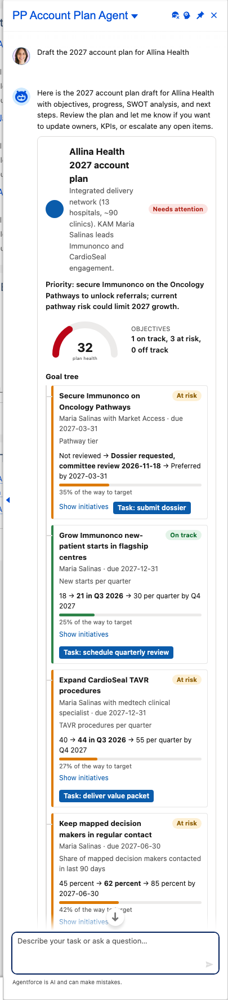

# Scenario: Draft the 2027 account plan (Account Plan Builder agent)

**Persona:** key account manager for a health-system (IDN) account. **Agent:** `PP_Account_Plan_Agent` · **Lightning type:** `ppAccountPlan`

## The story
The KAM has to turn a year of account knowledge into a 2027 plan. The agent drafts goals, objectives with progress, a SWOT and stakeholders, and scores the plan's health from the objectives.

## Script
1. As the rep, choose **PP Account Plan Agent**.
2. Say: *"Draft the 2027 account plan for Allina Health"*

## Expected outcome

- Header with a plan-health badge and a **plan health gauge** (average objective progress).
- **Goal tree:** objectives with progress bars and on-track / at-risk / behind status taken from the 'Plan objective' facts.
- **SWOT** and a next step, plus buttons to create the follow-up task or copy the plan.

## What to customize
Prompt template `PP_Account_Plan`, facts `AP_*`, LWC `ppAccountPlanCard`, `PPAccountPlanService.health()`.

## Notes
- All account names, numbers and dates come from the fictional scenario facts (`PP_Scenario_Fact__mdt`, persona `account_plan`), not from live data.
- Deterministic values (progress, tiers, quadrants, attainment, coverage status) are computed in Apex, so they stay consistent even if the model words things differently.
