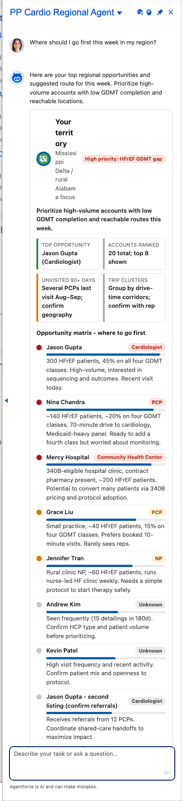
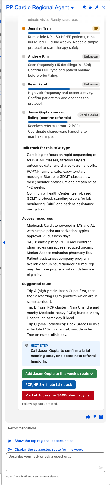

# Scenario: High-prevalence region, where to go first (Cardio Regional agent)

**Persona:** cardiology rep covering a high heart-failure-prevalence region (Mississippi Delta / rural Alabama in the demo). **Agent:** `PP_Cardio_Regional_Agent` · **Lightning type:** `ppRegionalOpportunity`

## The story
The rep has more HCPs than days. The agent ranks accounts by disease burden versus the GDMT (guideline-directed therapy) gap, adds drive-time realities and access resources (Medicaid, 340B, patient assistance), and proposes a route.

## Script
1. As the rep, choose **PP Cardio Regional Agent**.
2. Say: *"Where should I go first this week in my region?"*

## Expected outcome

- Territory header with a priority badge, and tiles for top opportunity, accounts ranked, unvisited 90+ days, and trip clusters.
- **Opportunity matrix:** ranked rows with a bar for relative opportunity and a chip for HCP type (Cardiologist, PCP, NP, Community Health Center), each explaining the patient volume and GDMT gap.
- Below the matrix: talk tracks by HCP type, access resources, a next step and buttons (e.g. *Add Jason Gupta to this week's route*, *PCP/NP 2-minute talk track*, *Market Access for 340B pharmacy list*).

## What to customize
Prompt template `PP_Cardio_Regional_Brief`, scenario facts with persona `cardio`, LWC `ppRegionalOpportunityCard`.

## Notes
- The HCP records in the org are California-based demo data. Region and clinical details come from the scenario facts, so locations in the card are not real geography.
- Known rough edges: the title can wrap into a narrow column, and an account can appear twice (for example a second listing for a referral hub).
