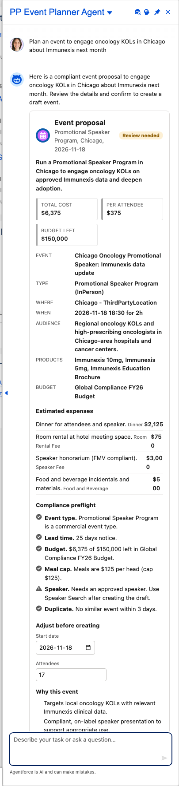
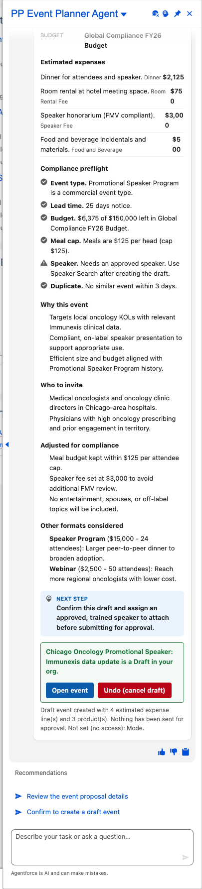
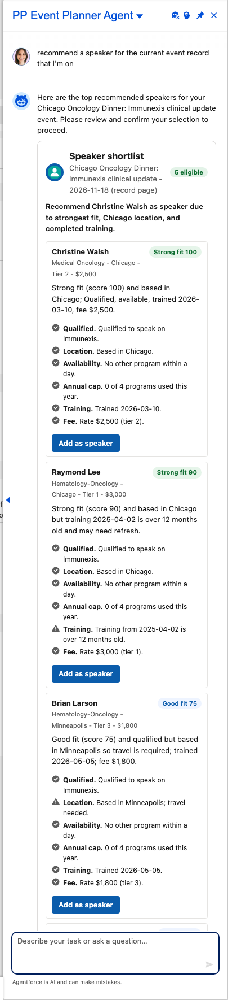
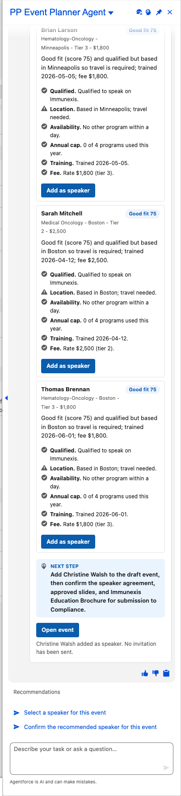
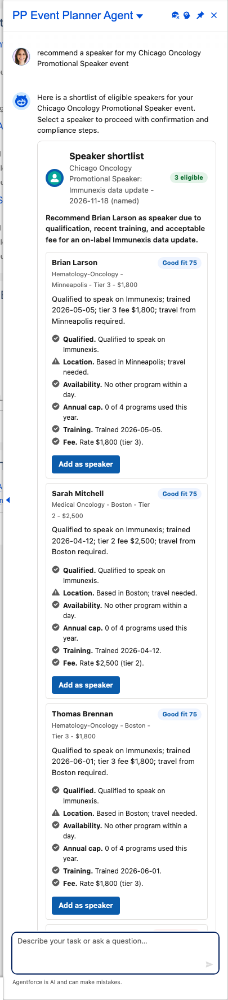

# Scenario: Suggest and draft an event (Event Planner agent)

**Persona:** Sales rep planning a speaker program, webinar or advisory board. **Agent:** `PP_Event_Planner_Agent` · **Lightning types:** `ppEventPlanner`, `ppSpeakerSearch`

This is the first Power Pack agent that **writes** to the org. It follows a *propose, confirm, write* pattern: the agent never inserts records by itself. The rep confirms with a button on the card, and the write runs as the rep.

## The story
The rep asks for an event. The agent looks at the org's event history (average cost and attendees by type), the budgets with funds left, the expense types and the products already used on events, then proposes one commercial event with a cost breakdown, a budget fit, who to invite and two alternative formats. A compliance preflight runs in Apex, not in the model. The rep can adjust the date and attendees (the checks re-run), then creates the Draft event, with an Undo.

## Script
1. As the rep, choose **PP Event Planner Agent**.
2. Say: *"Plan an event to engage oncology KOLs in Chicago about Immunexis next month"*
3. Review the card, adjust the date if you like, then choose **Create draft event**.
4. Choose **Open event** to see it, or **Undo (cancel draft)**.

## Expected outcome

- Proposal with total cost, cost per attendee, budget left, estimated expenses and **Who to invite**.
- **Compliance preflight** (pass / warn / block): commercial event type only, lead time (block under 14 days, warn under 21), budget fit, meal cap per head, speaker fee cap, speaker required for a Promotional Speaker Program, duplicate within 3 days.
- On create: a `MngEvent` in **Draft**, its `EstimatedExpense` lines, a `MngEventBudget` allocation and `MngEventProduct` rows. Nothing is sent for approval.

## Part 2: work on an existing event (Speaker Search)
The agent does not always start a new event. The **Speaker Search** topic works on an event that already exists and finds it in this order:
1. **The Managed Event record page the rep is on.** The agent reads the page context the same way as the Context Aware Agent (`afls-ideas/Context-Aware-Agent`): `currentRecordId`, `currentObjectApiName` and `currentPageType` are declared as `mutable string` with `visibility: "External"` and bound into the action with `with accountId = @variables.currentRecordId`. Without `External` the platform fails with *Something went wrong*. The Apex checks that the Id belongs to `MngEvent`.
2. **An event the rep names**, for example *"recommend a speaker for my Chicago Oncology Promotional Speaker event"*. Events are matched by the words in their name, best match first.
3. **The rep's newest Draft event.**
The card always says which one it used, for example *(record page)*, *(named)* or *(latest draft)*.

### Script
1. As the rep, open a Draft Managed Event they own, open the agent and choose **PP Event Planner Agent**.
2. Say: *"Recommend a speaker for the current event record that I'm on"*
3. Review the ranked speakers and choose **Add as speaker** (or **Undo**). Nothing is invited or sent.

### What the shortlist checks (all in Apex, the model only words the reason)
Approved and active expert, qualified on the event's product (`ExpertSubject` current on the event date), location against the event text, no other program within a day, annual program cap (warn at 3, block at 4), speaker training within 12 months, fee against the fee cap. The score ranks speakers and a blocked speaker is never offered.
- **Add as speaker** inserts a `MngEventParticipant` with the event type's expert role, as the rep, and re-checks everything on the server. If the rep can see the event but cannot edit it, the card says *View only* and offers no button.
- Test data: `tools/seed/seed_experts.apex` creates 9 speakers (one not qualified, one only nominated, one rejected).

## Event Brief: ask about an existing event or a person (read only)
Topic `event_insights`, action `PPEventBriefAction`, prompt template `PP_Event_Brief`, card `ppEventBriefCard`.
- On an event record, or naming an event: who is speaking, who is invited, accepted, declined or has not replied, who attended, budget and status, "summarize this event". Each speaker, attendee and colleague shows their earlier events (invited, replied, attended or no-show), repeat invitees, and a flag for anyone who missed an earlier event.
- On an Account: "which events has this HCP been invited to and did they show up".
- If the event already has a speaker, "who is speaking" summarises that speaker (programs this year, earlier events). "Recommend a speaker" on an event that already has one also summarises the speaker and offers a shortlist only when the rep asks for alternatives.
- Counts, flags and the person lists are computed in Apex; the model only writes the headline, insights and next step. Only an outcome of *No show* counts as missing an event; *Accepted* is a reply, not attendance.
- Routing: the router sends recommend, find, add and replace speaker requests to Speaker Search, new-event requests to the planner, and everything else about an existing event to the Event Brief.
- Gotcha: every topic's action must have a unique name (`build_event_insights_card`, `build_speaker_search_card`). When several topics all used `build_card`, the Event Brief data rendered in the Speaker Search card.

## How the write is kept safe
- `PPEventDraftController` is `with sharing` and inserts in user mode, so the rep's object and field access apply. Fields the rep cannot set (for example `Mode`) are skipped and reported on the card.
- The proposal is re-validated on the server at create time. Ids are resolved from names there, so a blocked proposal cannot be created by editing the client.
- All inserts are in one transaction (rolled back on any error). Undo sets the status to Cancelled instead of deleting.

## What to customize
Prompt templates `PP_Event_Planner`, `PP_Speaker_Search` and `PP_Event_Brief`, facts `EV_*` (event rules and type guide), LWCs `ppEventPlannerCard`, `ppSpeakerSearchCard` and `ppEventBriefCard`, thresholds and the commercial type list in `PPEventPlannerService` and `PPSpeakerSearchService`.

## Notes
- Next in this family: Invitee Finder (adds `MngEventParticipant`), Compliance Check and Closeout.
- Screenshots show the demo org and the test rep user.
