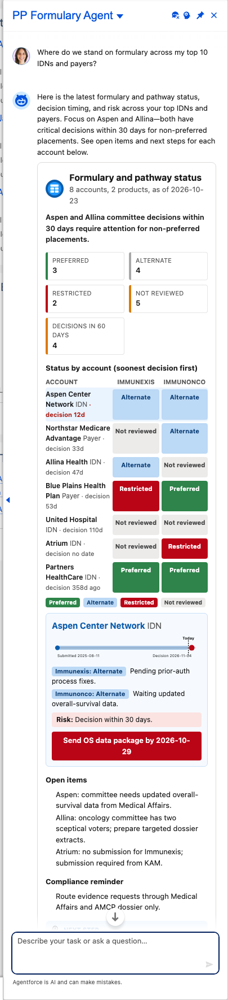

# Scenario: Formulary and pathway status (Formulary agent)

**Persona:** market access / national account director (NAD / RAD role). **Agent:** `PP_Formulary_Agent` · **Lightning type:** `ppFormularyMap`

## The story
The market access lead needs one view of where each product stands across IDNs and payers: tier, status, next decision date and risk. The agent applies its own compliance rules (no pricing or rebate talk; evidence only through approved channels).

## Script
1. As the rep, choose **PP Formulary Agent**.
2. Say: *"Where do we stand on formulary across my top 10 IDNs and payers?"*

## Expected outcome

- Tiles for Preferred, Alternate, Restricted, Not reviewed and decisions in the next 60 days.
- **Tier heatmap** (account by product), a **decision timeline** sorted by soonest decision, and risk notes per cell.
- Buttons to create a follow-up task or route to Contracting and Pricing.

## What to customize
Prompt template `PP_Formulary_Map`, facts `FM_*` (including `FM_Rules` and `FM_Roles`), LWC `ppFormularyMapCard`.

## Notes
- All account names, numbers and dates come from the fictional scenario facts (`PP_Scenario_Fact__mdt`, persona `formulary`), not from live data.
- Deterministic values (progress, tiers, quadrants, attainment, coverage status) are computed in Apex, so they stay consistent even if the model words things differently.
