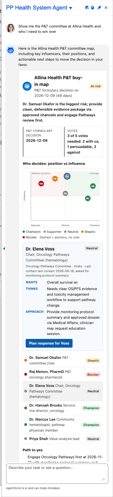
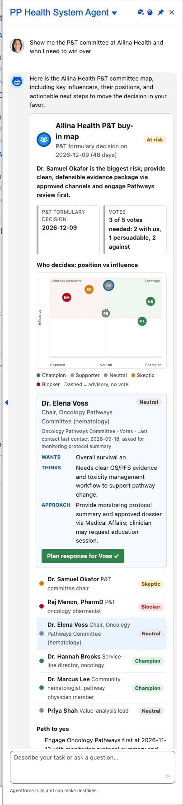

# Scenario: Winning P&T committee buy-in (Health System agent)

**Persona:** a key account rep managing an integrated health system whose formulary and pathway decisions are made by committees, not individual physicians.
**Agent:** `PP_Health_System_Agent` (topic `committee_map`) · **Lightning type:** `ppCommitteeMap` · **LWC:** `ppCommitteeMapCard`

## The story
Allina Health lists Immunonco as *Alternate* on its oncology pathway. A P&T formulary decision is due 2026-12-09. The rep needs to know who sits on the committee, where each person stands, what each one wants, and what the rep may appropriately do next, all inside the allowed channels (written information requests, the approved dossier via Medical Affairs, clinician-requested education). The map is built to support that; it does not help lobby.

## Script
1. Open the Agentforce panel as the rep and choose **PP Health System Agent**.
2. Say: *"Show me the P&T committee at Allina Health and who I need to win over"*

## Expected outcome

- **Header and tiles:** buy-in readiness badge (*At risk*), days to the decision, and a vote tally computed in Apex from member stance (3 of 5 votes needed: 2 with us, 1 persuadable, 2 against).
- **Chart:** each member is a point placed by position (Opposed to Champion) and influence, and colored by stance. A dashed ring means the member is advisory and has no vote. The *Address concerns* and *Leverage* quadrants make the swing votes obvious.
- **Annotations:** the highest-influence non-champion is preselected. The panel shows **Wants**, **Thinks** and **Approach**, plus the last contact date. Click any point or list row to switch member.
- **One-tap action per member:** for example *Plan response for Voss* creates a Task for the rep, linked to the account.
- **Account link:** the selected member's name opens their account record when one exists (see *About the data*).
- **Path to yes / Do not:** a compliant sequence of steps, and the lobbying behaviours to avoid.

## About the data
The committee members (Dr. Elena Voss, Raj Menon, and so on) are **fictional demo facts** stored in custom metadata, not Salesforce records. When a member's name matches a **person account** in the org, the member's name in the detail panel becomes a link to that account. Members with no matching account are shown without a link. To get links in your own org, create person accounts with the same names, or edit the member rows to use real HCP names.

## What to customize
| Want to change | Edit |
|---|---|
| Who is on the committee, stance, position, influence, wants, approach | Custom metadata `PP_Scenario_Fact__mdt`, category *Committee member* (one row per member) |
| Personality, compliance rules, how the path to yes is written | Prompt template `PP_Committee_Map` (published template versions are immutable, so bump the version when editing) |
| Layout, quadrants, colors | LWC `ppCommitteeMapCard` |

The vote tally and badge are computed in `PPCommitteeMapService.tally`, not by the LLM.

## Notes
- Screenshots show org and user details. Review before publishing.
- The card retries the model once if its JSON cannot be parsed, and shows a short retry message if both attempts fail.
- Known rough edge: the LLM sometimes writes "unknown" for a member's last contact even when the facts have a date.
