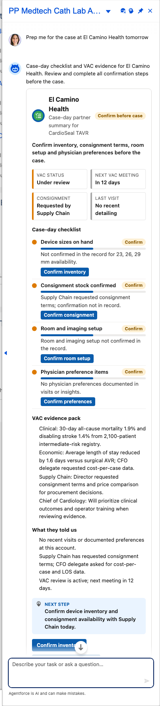
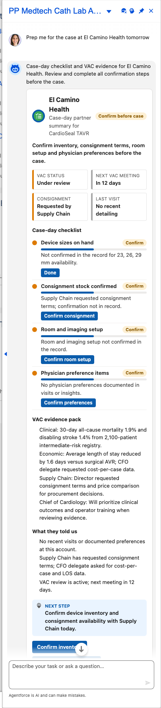

# Scenario: Cath lab case-day readiness (Medtech Cath Lab agent)

**Persona:** medtech rep supporting TAVR cases in the cath lab. **Agent:** `PP_Medtech_Cath_Agent` · **Lightning type:** `ppCaseDay`

## The story
Before a case the rep must confirm device sizes, consignment, room and imaging setup and physician preferences, and know where the hospital's Value Analysis Committee (VAC) stands. The agent builds that checklist from account data and scenario facts, and every open item has a one-tap action.

## Script
1. As the rep, choose **PP Medtech Cath Lab Agent**.
2. Say: *"Prep me for the case at El Camino Health tomorrow"*

## Expected outcome

- Badge (*Confirm before case*), VAC status, days to the next VAC meeting, consignment status and last visit.
- **Case-day checklist:** device sizes, consignment, room and imaging setup, physician preferences, each with a status chip and a button that creates a Task.
- **VAC evidence pack:** clinical, economic and supply-chain points per VAC role.
- **What they told us**, a next step, and more buttons below (e.g. *VAC evidence summary*, *Provide consignment terms*).

## What to customize
Prompt template `PP_Medtech_Case_Brief`, scenario facts with persona `medtech`, LWC `ppCaseDayCard`.

## Notes
The agent label is "PP Medtech Cath Lab Agent". The shared card service now retries once when the model returns JSON that cannot be parsed.
