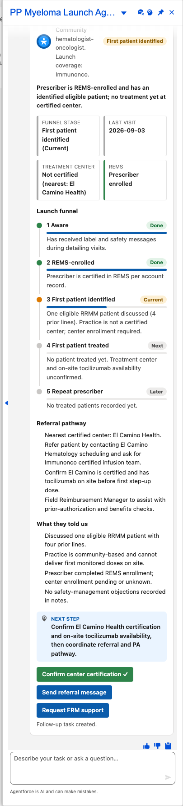

# Scenario: Multiple myeloma launch (Myeloma Launch agent)

**Persona:** oncology rep launching a new multiple myeloma therapy. **Agent:** `PP_Myeloma_Launch_Agent` · **Lightning type:** `ppLaunchFunnel`

## Script
1. As the rep, choose **PP Myeloma Launch Agent**.
2. Say: *"Brief me on Aaron Norita for the myeloma launch"*

## Expected outcome

- Funnel stepper (Aware, REMS-enrolled, First patient identified, First patient treated, Repeat prescriber) with the current stage highlighted.
- Tiles for funnel stage, last visit, treatment-center certification and REMS status.
- **What they told us** and **Referral pathway** sections built from visit notes and scenario facts.
- A next step and three buttons. *Confirm center certification* creates a Task (verified: the button turns green with "Follow-up task created.").

## What to customize
Prompt template `PP_Myeloma_Launch_Brief`, scenario facts with persona `myeloma`, and the `ppLaunchFunnelCard` LWC.
