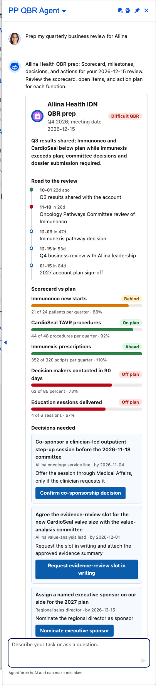

# Scenario: Cross-functional account huddle / QBR prep (QBR agent)

**Persona:** KAM leading a quarterly business review with Sales, Market Access, Medical Affairs, Marketing and Operations. **Agent:** `PP_Qbr_Agent` · **Lightning type:** `ppQbr`

## The story
The agent builds the QBR storyboard: road to the review, scorecard versus plan, decisions needed and actions by function. It keeps commercial and medical separate: commercial does not direct Medical, MSL call notes never enter the deck, and Medical joins only the evidence/education segment.

## Script
1. As the rep, choose **PP QBR Agent**.
2. Say: *"Prep my quarterly business review for Allina"*

## Expected outcome

- Badge reflecting how many metrics are behind and how many decisions are open.
- **Timeline** of milestones, **scorecard** bars with Ahead / On plan / Behind / Off plan (>=105, 90-104, 75-89, <75 percent of plan), **decision cards** with one-tap actions, and **swimlanes** by function.
- A 'Medical firewall' section listing what Medical Affairs may join and what is excluded.

## What to customize
Prompt template `PP_Qbr`, facts `QB_*` (scorecard, milestone, decision, action and sharing rules), LWC `ppQbrCard`, thresholds in `PPQbrService`.

## Notes
- All account names, numbers and dates come from the fictional scenario facts (`PP_Scenario_Fact__mdt`, persona `qbr`), not from live data.
- Deterministic values (progress, tiers, quadrants, attainment, coverage status) are computed in Apex, so they stay consistent even if the model words things differently.
