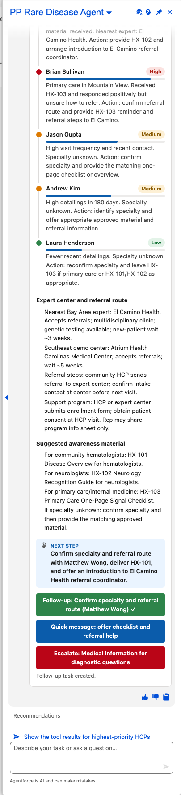

# Scenario: Shortening the diagnostic journey (Rare Disease agent)

**Persona:** rare-disease hematology/neurology rep who raises disease awareness so undiagnosed patients are recognized sooner. **Agent:** `PP_Rare_Disease_Agent` · **Lightning type:** `ppDiagnosticJourney`

## Script
1. As the rep, choose **PP Rare Disease Agent**.
2. Say: *"Where should I focus to find undiagnosed patients in my territory?"*

## Expected outcome

- HCPs ranked by likelihood of seeing an undiagnosed patient (High / Medium / Low), each with a recommended action.
- **Expert center and referral route:** nearest centers, wait times, referral steps and the support program.
- **Suggested awareness material** matched to HCP specialty, with approved materials only.
- A next step and three buttons: a follow-up Task (verified: the button turns green with "Follow-up task created."), a quick message to copy, and an escalation to Medical Information for diagnostic questions.

## What to customize
Prompt template `PP_Rare_Disease_Brief`, scenario facts with persona `rare`, LWC `ppDiagnosticJourneyCard`.
