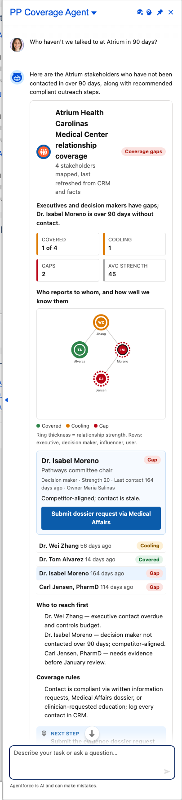

# Scenario: Stakeholder coverage and relationship health (Coverage agent)

**Persona:** KAM covering an IDN or academic centre. **Agent:** `PP_Coverage_Agent` · **Lightning type:** `ppCoverageMap`

## The story
The agent shows the account's decision-makers as an org chart, ring thickness for relationship strength and colour for coverage (Covered / Cooling / Gap), and tells the KAM who to reach first through approved channels.

## Script
1. As the rep, choose **PP Coverage Agent**.
2. Say: *"Who haven't we talked to at Atrium in 90 days?"*

## Expected outcome

- Tiles for covered, cooling, gaps and average strength.
- **Network:** nodes in rows by seniority; click a node for role, strength, days since contact and a suggested action.
- 'Who to reach first' and the coverage rules (Covered: contact within 60 days and strength 50+; Gap: no contact or more than 90 days).

## What to customize
Prompt template `PP_Coverage_Map`, facts `CV_*` (including `CV_Rules`), LWC `ppCoverageMapCard`, status rule in `PPCoverageMapService`.

## Notes
- All account names, numbers and dates come from the fictional scenario facts (`PP_Scenario_Fact__mdt`, persona `coverage`), not from live data.
- Deterministic values (progress, tiers, quadrants, attainment, coverage status) are computed in Apex, so they stay consistent even if the model words things differently.
