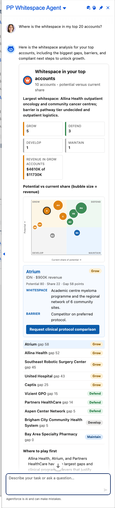

# Scenario: Whitespace and opportunity in the top accounts (Whitespace agent)

**Persona:** KAM / territory manager planning where to invest time. **Agent:** `PP_Whitespace_Agent` · **Lightning type:** `ppWhitespaceMap`

## The story
The agent plots each account by potential versus current share, sized by revenue, and sorts them into Grow / Defend / Develop / Maintain with the specific whitespace and barrier for each.

## Script
1. As the rep, choose **PP Whitespace Agent**.
2. Say: *"Where is the whitespace in my top 20 accounts?"*

## Expected outcome

- Tiles per quadrant plus revenue in the Grow accounts.
- **Bubble matrix** (click a bubble or row for the whitespace, barrier and a suggested next action).
- Ranked list by gap (potential minus share) and a 'Where to play first' section.

## What to customize
Prompt template `PP_Whitespace_Map`, facts `WS_*` (including `WS_Guidance`), LWC `ppWhitespaceMapCard`; quadrant rule in `PPWhitespaceMapService` (potential and share thresholds at 50).

## Notes
- All account names, numbers and dates come from the fictional scenario facts (`PP_Scenario_Fact__mdt`, persona `whitespace`), not from live data.
- Deterministic values (progress, tiers, quadrants, attainment, coverage status) are computed in Apex, so they stay consistent even if the model words things differently.
